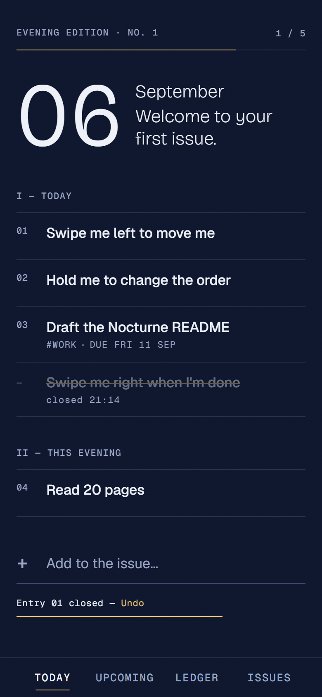
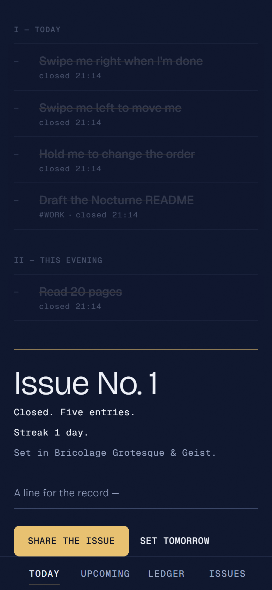
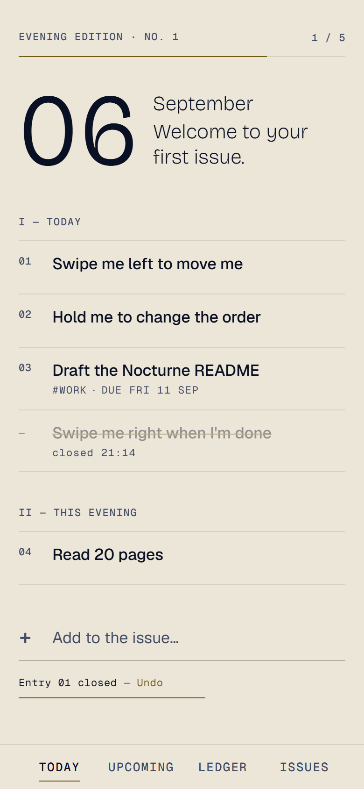
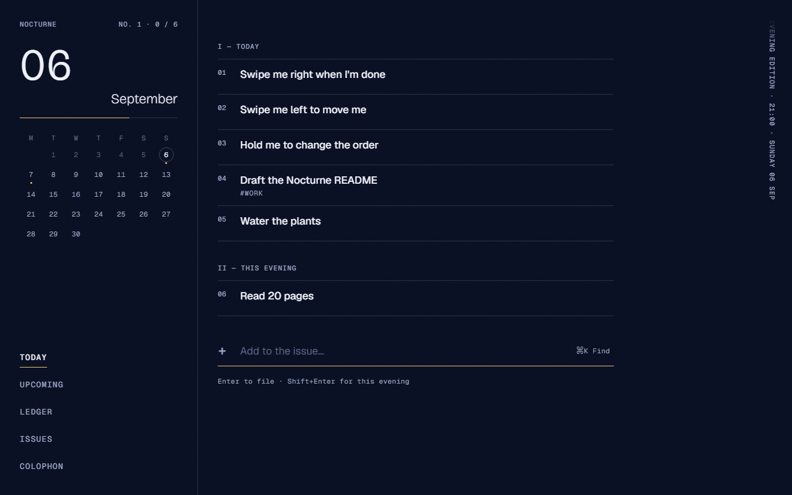

# Nocturne

*Your day, printed as a single issue.*

**Status: v0.1.1 — the Android APK is built.** Install `release/nocturne-0.1.1.apk` on your phone (copy it over, open it, allow "install unknown apps" once). It was smoke-tested on an Android 14 emulator: launch, swipe-to-strike, quick add, a reminder notification with working Done/Snooze, and updating over the previous version with data kept. The web/PWA build and CI workflows are also here if you ever want them.

<p>
  
  
  
</p>


## What it is

- A local-first daily to-do and habit tracker. Today is an "issue": a masthead, folio-numbered entries between hairlines, and a colophon that prints when you strike the last entry.
- Plain-English quick add: `Call mom tomorrow 17:00 every week #family`. The parser is chrono-node plus a small deterministic grammar for `every …`, `#tags`, `by <date>` and `tonight`.
- Swipe right to strike, swipe left for *When?*, hold to reorder. There is a 5-second undo. Overdue entries roll forward to today.
- Recurrence engine: daily/every N days, weekdays, weekly on days (and every 2 weeks), monthly on day N or the last day, yearly. Each can be fixed or counted after completion.
- Ledger: daily, some-days or N-times-a-week habits, current and best streak, Loop-style strength ring, a 12-week heatmap, one freeze token per week.
- Back Issues: every day as a numbered issue with its standfirst and weekly review heads. Tap one for its frozen front page.
- Night, Proof and Auto themes. The evening turn happens at your evening hour. Reduced motion is honoured. Sound is synthesised and off by default. Haptics work on Android.
- Backups: a JSON export/import, a Markdown export, and a GitHub Gist backup with your own token. Gist backup can run automatically every 6 hours with last-writer-wins merge. A share card renders the day as a 1080×1920 PNG.
- Android (Capacitor 8): real reminders (`AlarmManager`), a 21:00 daily review, Done/Snooze actions, deep links (`nocturne://today|entry/<id>|complete/<id>`), an exact-alarm footnote and a "Not firing?" note.
- No account, no server, no analytics. The production bundle makes **zero network requests** until you configure a Gist backup.

## Build the APK (Android)

```powershell
.\scripts\build-apk.ps1 -Version 0.1.2 -Code 3
```

This builds the Android web bundle (no service worker), syncs it into `android/`, and produces a signed `release/nocturne-<version>.apk`. Raise `-Code` on every build so it installs over the previous one. The toolchain (JDK 21, Android SDK) and **your signing key** live in `C:\Work\android-toolchain` (outside the repo). **Back up `C:\Work\android-toolchain\keys\`** (the `.p12` and `.pass` files): a phone only accepts updates signed with the same key.

On the phone, the first time you set a reminder Android may deliver it a few minutes late; for on-the-minute reminders allow **Settings → Apps → Nocturne → Alarms & reminders** (the app's Colophon → Exact alarms › opens it).

## Run it locally

```bash
npm ci
```

```bash
npm run dev
```

Open http://localhost:5173. Other scripts:

| Command | What |
|---|---|
| `npm run test:unit` | Vitest: engine golden tables incl. Berlin DST and ±14 h zones, repo on fake-indexeddb, gist client — with coverage |
| `npm run build` | Typecheck + production build (`VITE_BASE_PATH=/nocturne/` for the Pages shape) |
| `npm run test:e2e` | Playwright against the built app on port 4317: flows, gestures, token checks, 130 % text at 320 px, axe on every route (desktop + Pixel 7) |
| `SCREENS=1 npx playwright test e2e/screens.spec.ts --project=desktop-chromium` | Regenerates the README screenshots |
| `npm run lint` | Biome |
| `node scripts/size-gate.mjs` | Initial-JS budget check after a build |

On Git Bash for Windows, set `MSYS_NO_PATHCONV=1` before passing `--base /nocturne/` on the command line. Otherwise Git Bash rewrites the path into `C:/Program Files/Git/nocturne/`.

## Go live (your steps, about 20 minutes)

These steps publish a public repo and create your signing identity, so they were left for you.

1. **Repo + Pages.** In this folder:
   ```bash
   gh repo create nocturne --public --source . --push
   ```
   Then go to GitHub → *Settings → Pages → Source: GitHub Actions*. The `pages` workflow deploys `https://<you>.github.io/nocturne/`. The `ci` workflow runs lint, unit tests, e2e and an Android bundle-shape check.
2. **Test APK straight away (optional).** Go to *Actions → android-release → Run workflow*. Without a keystore it builds a **debug-signed** APK you can sideload for testing. Download it from the run's artifacts.
3. **Signing key (once for the life of the app).** Run this in Git Bash, outside the repo:
   ```bash
   cd /c/Work && bash /c/Work/Personal_Projects/_shared/scripts/make-keystore.sh nocturne
   ```
   Back up `nocturne-release.p12` and its passphrase in your password manager. If you lose it, future APKs cannot update the installed app.
4. **Secrets.** Run these one at a time. The two password commands prompt you to paste the passphrase:
   ```bash
   gh secret set ANDROID_KEYSTORE_BASE64 < /c/Work/nocturne-release.p12.b64
   ```
   ```bash
   gh secret set ANDROID_KEYSTORE_PASSWORD
   ```
   ```bash
   gh secret set ANDROID_KEY_ALIAS --body release
   ```
   ```bash
   gh secret set ANDROID_KEY_PASSWORD
   ```
   `ANDROID_KEY_PASSWORD` takes the same passphrase as the keystore. Delete the `.b64` file afterwards.
5. **Release.** Tag and push:
   ```bash
   git tag v0.1.0 && git push origin v0.1.0
   ```
   The Release page then carries `nocturne-0.1.0.apk` and `SHA256SUMS.txt`. Install it on the phone.
6. **On the phone**, walk the manual checklist in [docs/TESTING.md](docs/TESTING.md) and log the results in [docs/VERIFICATION-LOG.md](docs/VERIFICATION-LOG.md). The main items are:
   - A 3-minute reminder fires with the app closed.
   - The 21:00 review arrives, and it still fires after a reboot.
   - The exact-alarm footnote appears until you allow *Alarms & reminders*.

## Documents

| File | What |
|---|---|
| [GOAL.md](GOAL.md) | Goal, vibe, success criteria, non-goals, feature split |
| [docs/IMPLEMENTATION-NOTES.md](docs/IMPLEMENTATION-NOTES.md) | **What was built, the decisions taken, and where it deviates from the plan and why.** Read this first. |
| [docs/IMPLEMENTATION-PROMPT.md](docs/IMPLEMENTATION-PROMPT.md) | The original build spec (tokens, algorithms, workflows) |
| [docs/DESIGN.md](docs/DESIGN.md) · [design/preview.html](design/preview.html) | Design system and the visual contract |
| [docs/ARCHITECTURE.md](docs/ARCHITECTURE.md) · [docs/PLAN.md](docs/PLAN.md) · [docs/TESTING.md](docs/TESTING.md) · [docs/DEPLOYMENT.md](docs/DEPLOYMENT.md) · [docs/RESEARCH.md](docs/RESEARCH.md) | Planning set, written 2026-09-06 |
| [CHANGELOG.md](CHANGELOG.md) | Release notes |

## Layout

```
src/engine/     pure TypeScript: day keys, ordering, quick-add, recurrence, streaks, strength, issue,
                colophon, notification plan, merge, scale. No React, no Dexie, no Date.now(). Golden tests.
src/data/       Dexie schema, repo (the only writer), live-query hooks, backup, gist, auto-backup
src/features/   front-page, composer, entry sheets, week-spread, ledger, back-issues, colophon, sound
src/platform/   Capacitor seams: notifications, haptics, files/share, secrets, system (back, deep links)
src/styles/     tokens.css (the only file with hex values), app.css (hairlines, strike, sheets), fonts
e2e/            Playwright specs
android/        Capacitor Android project (committed; built only in CI)
```

## Attribution

Nocturne's own code is MIT ([LICENSE](LICENSE)). It bundles or depends on:

| Asset / library | Licence | Notes |
|---|---|---|
| Bricolage Grotesque (Mathieu Triay), Geist and Geist Mono (Vercel) | SIL OFL 1.1 | Latin woff2 subsets copied from Fontsource into `src/styles/fonts/` with their OFL texts; self-hosted and precached |
| Motion (`motion`) | MIT | Layout re-set, reorder, margin-word drag |
| Dexie, dexie-react-hooks | Apache-2.0 | IndexedDB storage |
| React, Zustand, chrono-node, Vite, vite-plugin-pwa (Workbox), Vitest, Playwright, Biome, Testing Library | MIT | Framework, parsing, build, tests |
| `fractional-indexing` (David Greenspan) | CC0-1.0 | Ordering keys |
| Capacitor and `@capacitor/*` plugins | MIT | Android shell, notifications, haptics, filesystem, share, preferences, status bar, keyboard, splash |
| axe-core (`@axe-core/playwright`) | MPL-2.0 | Dev-only accessibility checks; never shipped |
| Habit strength formula | Re-implemented from the published description of Loop Habit Tracker's score (`0.5^(sqrt(freq)/13)` smoothing) | Loop is GPL-3.0; no code copied, not a dependency |
| Sounds | None bundled | Synthesised with Web Audio |
| App icon, splash, share card | Original artwork | A geometric foil "N" on navy |

Runtime services (optional, user-configured, with the user's own token): the GitHub Gist REST API. Nothing is sent anywhere unless you configure it.
