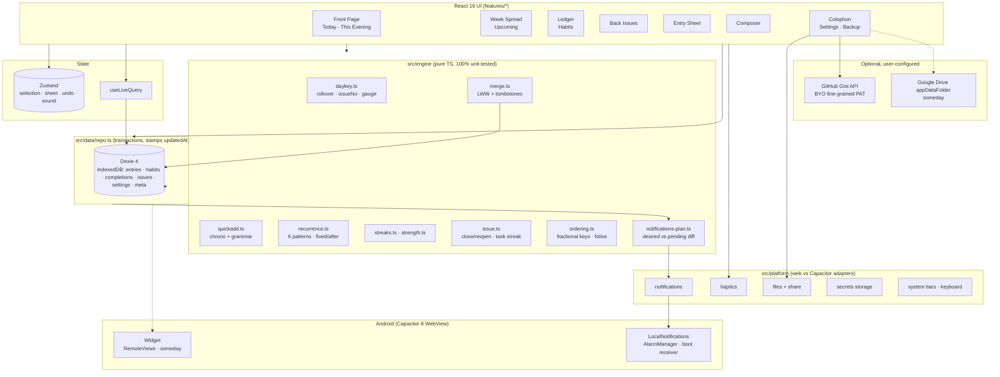

# Nocturne — Architecture

Written 2026-09-06. Binding alongside `docs/DESIGN.md` and `../_shared/DECISIONS.md` (this project is §D8 row 01). Versions below are the ones verified in `docs/RESEARCH.md` on the same day; pin them in `package.json`.

---

## 1. Stack

| Layer | Choice | Version (verified 2026-09-06) | Why for Nocturne |
|---|---|---|---|
| Build | Vite | 8.2.2 (MIT) | Static `dist/` for GitHub Pages and Capacitor; `base` parameterised per target |
| UI | React 19 + TypeScript (strict) | react 19.2.8 (MIT), TS as pinned by `create-vite` | D1; Motion/Dexie hooks are React-first |
| Styling | Tailwind CSS v4 (`@tailwindcss/vite`) + `src/styles/tokens.css` | 4.3.3 (MIT) | D7 token names; DESIGN.md §15 values; hand-written CSS for hairlines, strike, sheet |
| Motion | Motion (`motion/react`) | 13.2.0 (MIT) | `layout` re-set, `Reorder` for Folio Renumber, `drag="x"` for Margin Words, `AnimatePresence` for the colophon; no GSAP needed |
| Persisted data | Dexie + dexie-react-hooks + dexie-export-import | 4.4.5 / 4.4.0 / 4.4.0 (Apache-2.0) | IndexedDB, `useLiveQuery`, streaming JSON backup |
| UI state | Zustand | 5.0.15 (MIT) | Selection, open sheet, composer draft, undo, sound state |
| Routing | React Router 7 (`react-router`), `createHashRouter` | 7.x (MIT) | Deep links on Pages without 404 tricks; `nocturne://` maps to hash routes on Android |
| Dates | date-fns + `@date-fns/tz` | 4.4.0 / 1.5.0 (MIT) | Formatting, ISO weeks; day math itself is done on `{y,m,d}` integers (see §5.1) |
| Quick add | chrono-node (lazy-loaded chunk) | 2.10.1 (MIT) | Natural-language dates/times; our regex layer handles `every …`, `#tag`, `by …` |
| Recurrence | In-house `src/engine/recurrence.ts` | — | D8: rrule is unmaintained; six UI patterns need ~150 lines. RRULE string is only an export format |
| Ordering | `fractional-indexing` | 4.0.0 (CC0-1.0) | `generateKeyBetween` — one record touched per reorder |
| Primitives | shadcn/ui on Base UI (Dialog only) | via `npx shadcn@latest init` (MIT) | Focus trap + return, `role="dialog"`, Esc handling for the sheet |
| Icons | lucide-react | 1.41.0 (ISC) | Colophon screen only (DESIGN §11) |
| Fonts | `@fontsource-variable/bricolage-grotesque` (`/full.css`), `@fontsource-variable/geist`, `@fontsource-variable/geist-mono` | 5.3.0 (OFL 1.1) | Self-hosted latin subset; ≤ 350 KB total |
| Command palette (v1) | cmdk | 1.1.1 (MIT) | `⌘K` Quick Find on desktop |
| PWA | vite-plugin-pwa (Workbox) + `@vite-pwa/assets-generator` | 1.3.0 / 1.0.2 (MIT) | Precache shell + fonts; icons from one SVG |
| Android shell | `@capacitor/core`, `/android`, `/cli` | 8.5.1 (MIT) | Same `dist/`; built in CI with Temurin 21, AGP 8.13, Gradle 8.14.3 |
| Android plugins | `@capacitor/local-notifications` 8.3.1, `/haptics` 8.0.2, `/preferences` 8.0.1, `/filesystem` 8.1.3, `/share` 8.0.1, `/app` 8.1.1, `/status-bar` 8.0.3, `/splash-screen` 8.0.2, `/keyboard` 8.0.5 | MIT | Reminders, haptics, backup export, deep links, edge-to-edge, keyboard avoidance |
| Someday plugins | `capacitor-widget-bridge` 8.1.0 (MIT); `@capgo/capacitor-social-login` 8.5.5 (MPL-2.0) | — | Widget; Drive on Android |
| Tests | Vitest + Testing Library; Playwright (e2e + screenshots) | latest | Engine golden tests; screenshot contract vs `design/preview.html` |
| Lint/format | Biome | latest | One tool |
| Hosting / CI | GitHub Pages + GitHub Actions + GitHub Releases | free | D2/D3; no Worker (no secrets exist) |

**Deviations from DECISIONS.md, justified:** no `src/wit/` folder (Nocturne produces no witty text — the voice is fixed copy); no `worker/` (no secret anywhere); Howler is not used (all sounds are Web Audio synthesis, DESIGN §12); `rrule` is not a dependency (D8 says own engine).

---

## 2. System diagram



Data flow in one sentence: UI reads through `useLiveQuery`, writes through `repo.ts` (which stamps `updatedAt`, never hard-deletes, and calls the pure engine for derived values), and side effects (notifications, haptics, widget payload) hang off repo write hooks through the `platform/` adapters.

---

## 3. Folder layout (future repo `nocturne/`)

```
nocturne/
├── .github/workflows/
│   ├── pages.yml                  # copy of _shared/templates/pages.yml
│   └── android-release.yml        # copy of _shared/templates/android-release.yml
├── android/                       # generated by `npx cap add android`; committed
│   └── app/src/main/
│       ├── AndroidManifest.xml    # + nocturne:// intent-filter (§8)
│       ├── res/values/colors.xml  # tokens mirrored for splash/system bars/widget
│       ├── res/drawable/splash.xml
│       └── java/com/rahul/nocturne/   # MainActivity; widget provider (someday)
├── public/
│   ├── icons/                     # generated by @vite-pwa/assets-generator
│   └── sounds/ATTRIBUTION.md      # only if a CC0 sample is ever added
├── src/
│   ├── app/
│   │   ├── main.tsx               # fonts, tokens, MotionConfig, router, SW (web only)
│   │   ├── router.tsx             # createHashRouter: /, /upcoming, /ledger, /issues, /issues/:dayKey, /colophon
│   │   ├── Shell.tsx              # masthead slot, footer tabs / rail, grain overlay
│   │   └── providers.tsx          # theme, evening turn, day rollover ticker
│   ├── features/
│   │   ├── front-page/            # Masthead, DayGauge, RunningHead, EntryList, EntryRow, MarginWord, UndoFoot
│   │   ├── composer/              # Composer, ParsedChips, useQuickAdd
│   │   ├── entry/                 # EntrySheet, WhenSheet, RepeatPicker, ReminderRow, Checklist
│   │   ├── week-spread/           # DayHead, WeekSpread (phone run, desktop board)
│   │   ├── ledger/                # LedgerLine, StrengthRing, Heatmap12, HabitSheet
│   │   ├── back-issues/           # IssueRow, FrozenFrontPage, WeekReviewHead
│   │   ├── colophon/              # Colophon (end-of-day), Standfirst, ShareCard, Settings, BackupPanel
│   │   ├── onboarding/            # firstIssue.ts (the three sample entries)
│   │   └── sound/                 # synth.ts (tick, scale, thock, chime), useSound
│   ├── engine/                    # pure, framework-free; every file has a .test.ts twin
│   │   ├── daykey.ts  ordering.ts  quickadd.ts  recurrence.ts  streaks.ts
│   │   ├── strength.ts  issue.ts  notifications-plan.ts  merge.ts  ids.ts
│   │   └── __golden__/            # JSON fixtures: recurrence, streaks, strength, quickadd
│   ├── data/
│   │   ├── db.ts                  # Dexie schema + migrations
│   │   ├── repo.ts                # all writes; transactions; side-effect hooks
│   │   ├── backup.ts              # export/import/merge orchestration
│   │   ├── gist.ts                # Gist client (v1)
│   │   └── attribution.json
│   ├── components/ui/             # shadcn Dialog → Sheet, Button, Segmented, Input, Chip, Footnote, DigitRoll
│   ├── styles/
│   │   ├── tokens.css             # DESIGN.md §15 verbatim
│   │   ├── motion.ts              # spring/ease/dur exports
│   │   └── index.css              # Tailwind @theme inline bridge + hairline/strike/sheet CSS
│   └── platform/
│       ├── index.ts               # isNative(), platform switch
│       ├── notifications.ts       # web no-op vs LocalNotifications
│       ├── haptics.ts             # navigator.vibrate vs Haptics
│       ├── files.ts               # <a download> vs Filesystem+Share
│       ├── secrets.ts             # WebCrypto AES-GCM (web) vs Preferences (Android)
│       └── system.ts              # StatusBar, Keyboard, App listeners, deep links
├── e2e/                           # Playwright: flows + screenshots (phone/desktop, Night/Proof, reduced motion)
├── docs/                          # this folder
├── design/preview.html
├── capacitor.config.ts
├── vite.config.ts
├── biome.json
└── package.json
```

---

## 4. Data model (TypeScript)

All dates that mean "a calendar day" are `DayKey` strings (`"YYYY-MM-DD"`, local, rollover-adjusted). Instants are epoch milliseconds. Nothing is hard-deleted; `deletedAt` tombstones make merge trivial.

```ts
// src/engine/types.ts
export type DayKey = `${number}-${number}-${number}`;   // "2026-09-06"
export type Id = string;                                  // 12-char base62 from crypto.getRandomValues (engine/ids.ts)

export type Bucket = "today" | "upcoming" | "someday";    // "today" + when=today; "upcoming" + when>today; "someday" has no when

export interface Entry {                                  // a task; "entry" in the UI voice
  id: Id;
  title: string;
  notes: string;                                          // Markdown-ish plain text; "" when empty
  status: "open" | "done";
  bucket: Bucket;
  when?: DayKey;                                          // the day it is filed under (Things-style "when")
  evening: boolean;                                       // "This Evening" section (flag, not a bucket — decision D-01 below)
  deadline?: DayKey;                                      // vermilion countdown; overdue when deadline < today
  tags: string[];                                         // lower-case, no '#'
  order: string;                                          // fractional index within (bucket, when, evening) list
  checklist: ChecklistItem[];
  recurrence?: Recurrence;                                // present only on the *template-bearing* instance
  reminderAt?: number;                                    // epoch ms; local wall-clock at creation
  seriesId?: Id;                                          // shared by every instance of one recurring entry
  instanceNo?: number;                                    // 1-based, for "Instance 4 · every weekday"
  createdAt: number; updatedAt: number;
  completedAt?: number;                                   // ms; the "closed 21:14" stamp
  deletedAt?: number;
}

export interface ChecklistItem { id: Id; text: string; done: boolean; }

export type Recurrence =
  | { kind: "daily";    interval: number; mode: RecurrenceMode }                  // every N days
  | { kind: "weekdays"; mode: RecurrenceMode }                                    // Mon–Fri
  | { kind: "weekly";   interval: number; days: Weekday[]; anchor: DayKey; mode: RecurrenceMode } // every N weeks on days
  | { kind: "monthly";  interval: number; day: number | "last"; mode: RecurrenceMode }            // day 1..31 or last
  | { kind: "yearly";   month: number; day: number; mode: RecurrenceMode };       // month 1..12
export type RecurrenceMode = "fixed" | "afterCompletion";
export type Weekday = 0 | 1 | 2 | 3 | 4 | 5 | 6;                                // 0 = Sunday (JS convention)

export interface Habit {
  id: Id;
  title: string;
  frequency: { times: number; per: "day" | "week" };      // {1,"day"} daily; {3,"week"} frequency habit (v1)
  scheduleDays?: Weekday[];                               // day-specific daily habits ("Mon Wed Fri")
  reminder?: { hour: number; minute: number };            // v1
  freezes: number;                                        // streak-freeze tokens available (v1)
  order: string;
  createdAt: number; updatedAt: number; archivedAt?: number; deletedAt?: number;
}

export interface Completion {                             // one per habit per day; append-mostly
  id: Id;                                                 // `${habitId}:${dayKey}` — deterministic so union-merge dedupes
  habitId: Id;
  dayKey: DayKey;
  value: number;                                          // 1 = done; 0 with frozen=true = freeze token spent
  frozen?: boolean;
  ts: number;                                             // instant of the tap (never rewrites history on tz change)
  updatedAt: number; deletedAt?: number;
}

export interface Issue {                                  // one per calendar day that had ≥ 1 entry
  dayKey: DayKey;                                         // primary key
  issueNo: number;                                        // see §5.1 — days since first issue + 1
  total: number;                                          // entries filed for the day (today + evening), excluding deleted
  done: number;
  closedAt?: number;                                      // set when done === total && total ≥ 1; cleared on reopen
  standfirst?: string;                                    // "A line for the record —"
  streakAtClose?: number;                                 // consecutive closed issues incl. this one
  updatedAt: number;
}

export interface Settings {                               // single row, key "settings"
  theme: "night" | "proof" | "auto";
  eveningHour: number;                                    // default 21
  dayRolloverHour: number;                                // default 3
  motion: "system" | "reduced";
  sound: { enabled: boolean; quietFrom: number; quietTo: number; master: number };  // default off, 23–8, 0.35
  dailyReview: { enabled: boolean; hour: number; minute: number };                  // default on, 21:00 (Android only)
  firstIssueDay: DayKey;                                  // set on first launch; drives issueNo
  readerName?: string;                                    // "Good evening, Rahul."
  backup: { gistId?: string; lastBackupAt?: number; lastBackupRevision?: number; auto: boolean };
  onboardingDone: boolean;
}

export interface Meta { key: string; value: unknown }     // "revision" (monotonic int), "lastSyncAt", "schemaVersion"
```

```ts
// src/data/db.ts
import Dexie, { type EntityTable } from "dexie";
export const db = new Dexie("nocturne") as Dexie & {
  entries: EntityTable<Entry, "id">;
  habits: EntityTable<Habit, "id">;
  completions: EntityTable<Completion, "id">;
  issues: EntityTable<Issue, "dayKey">;
  settings: EntityTable<Settings & { key: "settings" }, "key">;
  meta: EntityTable<Meta, "key">;
};
db.version(1).stores({
  entries:     "id, bucket, when, status, seriesId, updatedAt, deletedAt, reminderAt, *tags, [bucket+when]",
  habits:      "id, archivedAt, updatedAt",
  completions: "id, habitId, dayKey, [habitId+dayKey], updatedAt",
  issues:      "dayKey, closedAt, updatedAt",
  settings:    "key",
  meta:        "key",
});
```

**Model decisions (answering RESEARCH.md §10 open questions 7 and 8):**
- **D-01** "This Evening" is a **flag** on an entry, not a bucket: an evening entry is still part of Today's issue and counts toward the colophon. Shift+Enter in the composer sets it.
- **D-02** Habits and tasks are **separate surfaces** (Front Page vs Ledger), so `order` is scoped per list and habits never appear in the issue counter.
- **D-03** Day rollover default is **03:00**; evening hour default **21:00**.
- **D-04** The issue number is **days since the reader's first issue + 1** (`firstIssueDay`), so the first open is "No. 1" (DESIGN §9.8) and a reader who started on 1 Jan sees "No. 249" on 6 Sep (DESIGN §5.3's example). Switching to day-of-year is a one-line change in `issueNumber()`.
- **D-05** A recurring entry is a **series of instances**: the open instance carries `recurrence`; striking it clears its `recurrence` and creates the next instance with the same `seriesId`. Editing the repeat rule on any instance rewrites the open instance only.

---

## 5. Key algorithms

Every function below lives in `src/engine/`, takes plain data, and has a `.test.ts` with the worked examples as fixtures.

### 5.1 Day key, issue number, day gauge (`daykey.ts`)

Calendar math is done on `{y, m, d}` via `Date.UTC` so DST never shifts a day.

```ts
export const toKey = (y: number, m: number, d: number): DayKey =>
  `${y}-${String(m).padStart(2, "0")}-${String(d).padStart(2, "0")}` as DayKey;
export const parseKey = (k: DayKey) => { const [y, m, d] = k.split("-").map(Number); return { y, m, d }; };
export function addDays(k: DayKey, n: number): DayKey {
  const { y, m, d } = parseKey(k);
  const t = new Date(Date.UTC(y, m - 1, d + n));
  return toKey(t.getUTCFullYear(), t.getUTCMonth() + 1, t.getUTCDate());
}
export const daysBetween = (a: DayKey, b: DayKey) =>
  Math.round((Date.UTC(...ymd(b)) - Date.UTC(...ymd(a))) / 86_400_000);    // ymd() → [y, m-1, d]
export const weekdayOf = (k: DayKey): Weekday => new Date(Date.UTC(...ymd(k))).getUTCDay() as Weekday;
export const daysInMonth = (y: number, m: number) => new Date(Date.UTC(y, m, 0)).getUTCDate();

/** "Today" for the app: local wall clock shifted back by the rollover hour. */
export function todayKey(now: Date, rolloverHour: number): DayKey {
  const t = new Date(now.getTime() - rolloverHour * 3_600_000);            // shift, then read LOCAL fields
  return toKey(t.getFullYear(), t.getMonth() + 1, t.getDate());
}
export const issueNumber = (dayKey: DayKey, firstIssueDay: DayKey) => daysBetween(firstIssueDay, dayKey) + 1;

/** Fraction of the current "issue day" elapsed, for the masthead rule. */
export function dayGauge(now: Date, rolloverHour: number): number {
  const minutes = (now.getHours() * 60 + now.getMinutes() - rolloverHour * 60 + 1440) % 1440;
  return minutes / 1440;
}
export const isEvening = (now: Date, eveningHour: number, rolloverHour: number) =>
  now.getHours() >= eveningHour || now.getHours() < rolloverHour;
```

Worked examples (rollover 3, first issue 2026-01-01):
- `todayKey(2026-09-07 01:30 local)` → shift to 2026-09-06 22:30 → `"2026-09-06"` (a 1 a.m. strike still counts for Sunday).
- `issueNumber("2026-09-06", "2026-01-01")` = 248 + 1 = **249**.
- `dayGauge(21:14)` = (1274 − 180) / 1440 = 1094 / 1440 = **0.76** → 76 % of the rule is foil.
- Rollover ticker: `providers.tsx` recomputes `todayKey` every 60 s and on `visibilitychange`; when it changes, the masthead rolls (DESIGN §8.1 step 3), the climbing-scale index resets, and the sample-issue/colophon state re-evaluates.

### 5.2 Sections and folio numbers (`ordering.ts`)

The Front Page is derived, never stored:

```
today = entries where status ∈ {open, done} and bucket="today" and when = todayKey and !deletedAt
   ∪ entries where status="open" and when < todayKey                      // overdue "when" rolls forward visually
section I  (TODAY)        = today where !evening, ordered by (status asc: open first, order asc)
section II (THIS EVENING) = today where evening, same ordering
folio(entry) = 1-based index over I ++ II counting only open entries; done entries show "—"
```

Ordering keys come from `fractional-indexing`:

```ts
import { generateKeyBetween } from "fractional-indexing";
export const keyAtEnd   = (keys: string[]) => generateKeyBetween(keys.at(-1) ?? null, null);
export const keyBetween = (a: string | null, b: string | null) => generateKeyBetween(a, b);
// Reorder: moving X to position i in list L (excluding X):
//   newKey = keyBetween(L[i-1]?.order ?? null, L[i]?.order ?? null)   → exactly one record written
// Renumber the list (rewrite all keys with generateNKeysBetween(null, null, n)) when any key length > 40.
```

Worked example: keys `["a0","a1","a2"]`; moving the third entry between the first two → `generateKeyBetween("a0","a1")` = `"a0V"`; the list is now `a0, a0V, a1` and folios re-roll `01 02 03` from the new order.

### 5.3 Quick-add grammar (`quickadd.ts`)

Deterministic ladder; each rung consumes a span of the input and records a chip. chrono-node is loaded lazily (`import("chrono-node")`) the first time the composer is focused.

```ts
export interface Parsed {
  title: string;
  when?: DayKey; time?: { hour: number; minute: number };      // time → reminderAt on `when` (or today)
  deadline?: DayKey;
  recurrence?: Recurrence;
  tags: string[];
  evening: boolean;
  chips: { kind: "when" | "time" | "deadline" | "repeat" | "tag" | "evening"; text: string; span: [number, number] }[];
}

const EVERY = /\bevery\s+(day|weekday|week|month|year|other\s+day|(\d+)\s+(days?|weeks?)|(mon|tue|wed|thu|fri|sat|sun)[a-z]*(?:(?:\s*,\s*|\s+and\s+|\s*\/\s*)(mon|tue|wed|thu|fri|sat|sun)[a-z]*)*)\b(\s+after\s+done)?/i;
const TAG   = /(^|\s)#([\p{L}\p{N}_-]+)/gu;
const BY    = /\b(?:by|due)\s+([^#]+?)(?=\s+#|\s+every\b|$)/i;

export async function parseQuickAdd(input: string, today: DayKey, ref: Date): Promise<Parsed> {
  let text = input; const chips = [];
  // 1. recurrence first (so chrono never sees "every monday")
  const ev = EVERY.exec(text);
  if (ev) { recurrence = recurrenceFrom(ev, today); chips.push(chip("repeat", ev)); text = blank(text, ev); }
  // 2. tags
  for (const m of text.matchAll(TAG)) { tags.push(m[2].toLowerCase()); chips.push(chip("tag", m)); }
  text = text.replace(TAG, " ");
  // 3. deadline: "by friday" / "due 12 sep"
  const by = BY.exec(text);
  if (by) { const r = chrono.parse(by[1], ref, { forwardDate: true })[0]; if (r) { deadline = keyOf(r.start.date()); chips.push(chip("deadline", by)); text = blank(text, by); } }
  // 4. remaining date/time → when (+ time)
  const r = chrono.parse(text, ref, { forwardDate: true })[0];
  if (r) { when = keyOf(r.start.date()); if (r.start.isCertain("hour")) time = { hour: r.start.get("hour"), minute: r.start.get("minute") ?? 0 }; chips.push(chip(time ? "time" : "when", r)); text = blank(text, r); }
  // 5. weekly recurrence with no explicit days anchors on `when` (or today)
  if (recurrence?.kind === "weekly" && recurrence.days.length === 0) recurrence.days = [weekdayOf(when ?? today)];
  return { title: text.replace(/\s{2,}/g, " ").trim(), when, time, deadline, recurrence, tags, evening: false, chips };
}
```

`recurrenceFrom` maps: `day` → daily/1; `other day` → daily/2; `N days` → daily/N; `weekday` → weekdays; `week` → weekly/1 with days `[]` (filled in step 5); `N weeks` → weekly/N; `mon, wed and fri` → weekly/1 days `[1,3,5]`; `month` → monthly/1 on `day(when ?? today)`; `year` → yearly on `when ?? today`. A trailing `after done` sets `mode: "afterCompletion"`, otherwise `"fixed"`.

Worked example, typed on Sun 2026-09-06 at 20:10:
`Call mom tomorrow 17:00 every week #family`
1. `every week` → `{kind:"weekly", interval:1, days:[], anchor:"2026-09-07", mode:"fixed"}`, chip EVERY WEEK.
2. `#family` → tags `["family"]`, chip #FAMILY.
3. no `by`.
4. chrono: `tomorrow 17:00` → when `2026-09-07`, time 17:00 → chip TOMORROW 17:00.
5. weekly days ← `[weekdayOf("2026-09-07")]` = `[1]` (Monday — 2026-09-07 is a Monday).
Result: title **"Call mom"**, when 2026-09-07, `reminderAt` = 2026-09-07T17:00 local, weekly on Mondays, tag family. Tapping a chip removes its meaning and restores the text.

Edge rules: an input that parses to an empty title keeps the whole string as the title and drops the chips (never file a blank entry); `today`/`tonight` → when = today (tonight also sets `evening = true`); times without a date attach to `when ?? today`, and if that instant is already past, chrono's `forwardDate` moves it to tomorrow — the chip shows the resolved day so the user sees it.

### 5.4 Recurrence engine (`recurrence.ts`)

```ts
/** Next occurrence strictly after `base`. base = the instance's `when` (fixed) or the completion dayKey (afterCompletion). */
export function nextOccurrence(r: Recurrence, base: DayKey): DayKey {
  switch (r.kind) {
    case "daily":    return addDays(base, r.interval);
    case "weekdays": { let k = addDays(base, 1); while ([0, 6].includes(weekdayOf(k))) k = addDays(k, 1); return k; }
    case "weekly": {
      const anchorWeek = startOfWeek(r.anchor);                            // Monday of the anchor's week
      for (let k = addDays(base, 1), i = 0; i < 7 * r.interval + 7; k = addDays(k, 1), i++) {
        const weeksApart = daysBetween(anchorWeek, startOfWeek(k)) / 7;
        if (r.days.includes(weekdayOf(k)) && weeksApart % r.interval === 0) return k;
      }
      throw new Error("unreachable: weekly has ≥ 1 day");
    }
    case "monthly": {
      let { y, m } = parseKey(base);
      for (let step = 0; step < 24; step++) {
        m += r.interval; while (m > 12) { m -= 12; y++; }
        const dim = daysInMonth(y, m);
        const day = r.day === "last" ? dim : Math.min(r.day, dim);        // clamp from the STORED day → no drift
        const k = toKey(y, m, day); if (k > base) return k;
      }
      throw new Error("unreachable");
    }
    case "yearly": {
      let { y } = parseKey(base);
      for (;;) { y++; const k = toKey(y, r.month, Math.min(r.day, daysInMonth(y, r.month))); if (k > base) return k; }
    }
  }
}

/** Series-level bookkeeping when an instance is struck. Pure: returns the record to create (or null). */
export function spawnNext(done: Entry, completedOn: DayKey, nowMs: number): Entry | null {
  if (!done.recurrence) return null;
  const base = done.recurrence.mode === "afterCompletion" ? completedOn : (done.when ?? completedOn);
  const when = nextOccurrence(done.recurrence, base);
  return { ...done, id: newId(), status: "open", when, bucket: when === completedOn ? "today" : "upcoming",
           completedAt: undefined, checklist: done.checklist.map(c => ({ ...c, done: false })),
           reminderAt: done.reminderAt ? shiftReminder(done.reminderAt, done.when!, when) : undefined,
           instanceNo: (done.instanceNo ?? 1) + 1, order: keyAtEnd([]), createdAt: nowMs, updatedAt: nowMs };
}
```

Golden fixtures — the thirteen rows in `__golden__/recurrence.json`, identical to TESTING §2.1 and IMPLEMENTATION-PROMPT §6.4:

| # | Rule | Mode | base | next | then |
|---|---|---|---|---|---|
| R1 | daily/1 | fixed | 2026-09-06 | 2026-09-07 | — |
| R2 | weekdays | fixed | 2026-09-04 (Fri) | 2026-09-07 (Mon) | 2026-09-08 |
| R3 | weekly `[1,3,5]` | fixed | 2026-09-06 (Sun) | 2026-09-07 | 2026-09-09 |
| R4 | daily/3 | fixed | 2026-09-01 | 2026-09-04 | 2026-09-07 |
| R5 | daily/3 | afterCompletion, completed 09-06 | 2026-09-06 | 2026-09-09 | contrast with R4 |
| R6 | monthly/1 day 31 | fixed | 2026-01-31 | **2026-02-28** | 2026-03-31, 2026-04-30 (clamps from the stored 31 — never drifts to the 28th) |
| R7 | monthly/1 day `"last"` | fixed | 2026-02-28 | 2026-03-31 | 2026-04-30 |
| R8 | yearly 02-29 | fixed | 2024-02-29 | 2025-02-28 | 2026-02-28, 2027-02-28, 2028-02-29 |
| R9 | weekly/2 `[0]` anchor 09-06 | fixed | 2026-09-06 | 2026-09-20 | skips 09-13 |
| R10 | weekly/2 `[1,4]` anchor 09-07 | fixed | 2026-09-10 (Thu) | 2026-09-21 (Mon) | skips the week of 14 Sep |
| R11 | weekdays | fixed | 2026-10-23 (Fri) | 2026-10-26 (Mon) | across the EU DST change of 2026-10-25 — no skip, no duplicate |
| R12 | daily/1 | fixed | 2026-03-28 | 2026-03-29 | DST starts in `Europe/Berlin` |
| R13 | weekly `[0]` (Sun), when 09-07, completed late on 09-09 | fixed | 2026-09-07 | **2026-09-13** | fixed mode ignores the completion date; the next Sunday strictly after 09-07 is 09-13 |

Plus a property test (1,000 random rule/base pairs satisfy `next > base`, and `weekdayOf(next)` is in the allowed set for `weekly`/`weekdays`) and the daily case re-run under `Pacific/Kiritimati` (+14) and `Pacific/Pago_Pago` (−11).

Export: `toRRuleString(r, dtstart)` emits `FREQ=…;INTERVAL=…;BYDAY=…;BYMONTHDAY=…` for backups and future import; it is a one-way serialisation in MVP and **lossy for monthly-day-31**, because RFC 5545 skips short months where Nocturne clamps (§0.2 of the implementation prompt) — note that beside the function. `COUNT` and `UNTIL` are not representable in the `Recurrence` union and are out of scope for v1.

### 5.5 Streaks and strength (`streaks.ts`, `strength.ts`)

```ts
const scheduled = (h: Habit, k: DayKey) => !h.scheduleDays || h.scheduleDays.includes(weekdayOf(k));

/** Current streak: walk back from today; today is grace; unscheduled days are skipped, not counted. */
export function currentStreak(h: Habit, done: Set<DayKey>, today: DayKey): number {
  let streak = 0, k = today, first = true;
  for (let i = 0; i < 3660; i++, k = addDays(k, -1)) {
    if (scheduled(h, k)) {
      if (done.has(k)) streak++;
      else if (!first) break;                                   // today still open → keep walking
    }
    first = false;
  }
  return streak;
}

/** Best streak: longest run of consecutive *scheduled* days done, from the first completion to today. */
export function bestStreak(h: Habit, done: Set<DayKey>, today: DayKey): number {
  const first = [...done].sort()[0]; if (!first) return 0;
  let best = 0, run = 0;
  for (let k = first; k <= today; k = addDays(k, 1)) {
    if (!scheduled(h, k)) continue;
    run = done.has(k) ? run + 1 : 0; best = Math.max(best, run);
  }
  return best;
}

/** Frequency habits (v1): the unit is the ISO week; current week is grace. */
export function currentWeekStreak(h: Habit, done: Set<DayKey>, today: DayKey): number {
  let streak = 0, week = startOfWeek(today), first = true;
  for (let i = 0; i < 520; i++, week = addDays(week, -7)) {
    const n = countInRange(done, week, addDays(week, 6));
    if (n >= h.frequency.times) streak++; else if (!first) break;
    first = false;
  }
  return streak;
}
```

Strength — Loop's exponential smoothing, re-implemented from the formula (never from the GPL file):

```ts
export function strength(h: Habit, done: Set<DayKey>, frozen: Set<DayKey>, today: DayKey): number {
  const freq = h.frequency.per === "day" ? 1 : h.frequency.times / 7;
  const mult = Math.pow(0.5, Math.sqrt(freq) / 13);                 // daily: 0.5^(1/13) = 0.9481
  const first = [...done].sort()[0]; if (!first) return 0;
  let score = 0;
  for (let k = first; k <= today; k = addDays(k, 1)) {
    if (!scheduled(h, k) || frozen.has(k)) continue;               // skipped/frozen days leave the score untouched
    const check = h.frequency.per === "day"
      ? (done.has(k) ? 1 : 0)
      : Math.min(1, countInRange(done, addDays(k, -6), k) / h.frequency.times);   // rolling 7-day window
    score = score * mult + check * (1 - mult);
  }
  return Math.round(score * 100);                                    // 0–100 for the ring
}
```

Worked numbers (daily habit, from zero): after n consecutive days `score = 1 − 0.9481ⁿ` → n = 7: 31 %; n = 13: **50 %** (that is the half-life); n = 30: 80 %. One miss after 30 days: 0.798 × 0.9481 = 0.757 → **76 %** — visible, survivable, exactly GOAL.md criterion 6. A 3×/week habit uses `mult = 0.5^(sqrt(3/7)/13) = 0.9657`, so it moves more slowly.

Streak worked example: schedule Mon–Fri; today Sun 2026-09-06; done {09-04, 09-03, 09-02}; 09-01 missed. Walk: Sun unscheduled (skip), Sat unscheduled (skip), Fri +1, Thu +2, Wed +3, Tue missed → stop. **Current 3.**

Task streak (for the colophon): `issueStreak(issues, today)` = count consecutive `Issue.closedAt` days walking back from *yesterday* (today counts once it closes), stopping at the first day that had an issue but was not closed; days with no issue at all are skipped (a day with nothing filed does not break the streak).

### 5.6 The strike transaction (`issue.ts` + `repo.ts`)

Everything the Ink Strike does happens in one Dexie transaction so Undo is a single inverse write:

```ts
export async function strike(entryId: Id, now = Date.now()): Promise<Undo> {
  return db.transaction("rw", db.entries, db.issues, db.meta, async () => {
    const e = await db.entries.get(entryId); if (!e || e.status === "done") throw new NotOpen();
    const today = todayKeyNow();
    const before = structuredClone(e);
    await db.entries.update(e.id, { status: "done", completedAt: now, updatedAt: now, recurrence: undefined });
    const next = spawnNext(e, today, now); if (next) await db.entries.add(next);
    const issue = await recomputeIssue(e.when ?? today, now);       // total/done/closedAt (§5.7)
    await bumpRevision();
    return { kind: "strike", before, nextId: next?.id, issueBefore: issue.before, expiresAt: now + 5000 };
  });
}
export async function undo(u: Undo) {   // called from UndoFoot within 5 s
  await db.transaction("rw", db.entries, db.issues, db.meta, async () => {
    await db.entries.put({ ...u.before, updatedAt: Date.now() });
    if (u.nextId) await db.entries.update(u.nextId, { deletedAt: Date.now(), updatedAt: Date.now() });
    if (u.issueBefore) await db.issues.put(u.issueBefore); else await db.issues.delete(u.before.when!);
    await bumpRevision();
  });
}
```

The UI never waits for the transaction to animate: the strike animation starts on pointer-up, `useLiveQuery` re-renders when the write lands (≤ 10 ms), and Motion `layout` handles the re-set.

### 5.7 Issue close / reopen (`issue.ts`)

```ts
export function deriveIssue(prev: Issue | undefined, dayEntries: Entry[], dayKey: DayKey, settings: Settings, now: number, streakBefore: number): Issue {
  const live = dayEntries.filter(e => !e.deletedAt);
  const total = live.length, done = live.filter(e => e.status === "done").length;
  const shouldClose = total >= 1 && done === total;
  const wasClosed = !!prev?.closedAt;
  return {
    dayKey, issueNo: issueNumber(dayKey, settings.firstIssueDay), total, done,
    closedAt: shouldClose ? (prev?.closedAt ?? now) : undefined,            // reopen clears it, so a re-close always stamps a fresh `now` (rule 3)
    streakAtClose: shouldClose ? (wasClosed ? prev!.streakAtClose : streakBefore + 1) : undefined,
    standfirst: prev?.standfirst, updatedAt: now,
  };
}
```

Rules: (1) closing happens only through a strike (not through deleting the last open entry — deleting the only open entry when others are done *does* close, because `done === total`; deleting the last entry of all leaves `total = 0` → no issue). (2) Adding an open entry to a closed day reopens it: `closedAt` is cleared, the colophon un-draws (AnimatePresence exit), the standfirst is kept. (3) Striking again re-closes with a fresh `closedAt`. (4) The colophon component renders when `issue.closedAt` is set and `dayKey === todayKey`; the Colophon Draw animation (DESIGN §8.5) plays only when `closedAt` changed during this session (tracked in Zustand), never on a cold open of an already-closed day.

### 5.8 Notification planning (`notifications-plan.ts`, `platform/notifications.ts`)

Pure planner + platform adapter. IDs are 31-bit positive ints (Java `int`); id 1 is reserved for the daily review.

```ts
export const notifId = (entryId: Id) => {                    // FNV-1a 32-bit, masked positive, never 0/1
  let h = 0x811c9dc5; for (const ch of entryId) { h ^= ch.charCodeAt(0); h = Math.imul(h, 0x01000193); }
  const v = (h >>> 0) & 0x7fffffff;
  return v < 2 ? v + 2 : v;                                    // 0 and 1 are reserved (1 = daily review)
};
export interface Planned { id: number; at: number; title: string; body: string; extra: { entryId?: Id; kind: "entry" | "review" } }

export function planNotifications(entries: Entry[], s: Settings, now: number): Planned[] {
  const horizon = now + 14 * 86_400_000;
  const perEntry = entries
    .filter(e => e.status === "open" && !e.deletedAt && e.reminderAt && e.reminderAt > now && e.reminderAt <= horizon)
    .map(e => ({ id: notifId(e.id), at: e.reminderAt!, title: e.title, body: e.notes.split("\n")[0] ?? "", extra: { entryId: e.id, kind: "entry" as const } }));
  return perEntry;                                              // the daily review is scheduled separately with `on:`
}

/** Diff desired vs pending; returns what to cancel and what to schedule. */
export function diffSchedules(desired: Planned[], pending: { id: number; at?: number }[]) {
  const want = new Map(desired.map(p => [p.id, p]));
  const cancel = pending.filter(p => p.id !== 1 && (!want.has(p.id) || want.get(p.id)!.at !== p.at)).map(p => p.id);
  const have = new Set(pending.filter(p => !cancel.includes(p.id)).map(p => p.id));
  const schedule = desired.filter(p => !have.has(p.id));
  return { cancel, schedule };
}
```

Adapter (Android):

```ts
export async function syncSchedules() {
  if (!isNative()) return;
  const { display } = await LocalNotifications.checkPermissions();
  if (display !== "granted") return;
  const desired = planNotifications(await db.entries.toArray(), settings, Date.now());
  const pending = (await LocalNotifications.getPending()).notifications.map(n => ({ id: n.id, at: n.extra?.at }));
  const { cancel, schedule } = diffSchedules(desired, pending);
  if (cancel.length) await LocalNotifications.cancel({ notifications: cancel.map(id => ({ id })) });
  if (schedule.length) await LocalNotifications.schedule({ notifications: schedule.map(p => ({
    id: p.id, title: p.title, body: p.body, actionTypeId: "ENTRY", extra: { ...p.extra, at: p.at },
    schedule: { at: new Date(p.at), allowWhileIdle: true }, smallIcon: "ic_stat_nocturne" })) });
  // daily review: `on:` is cron-like and re-arms itself with setExact*; `at`+repeats would be inexact setRepeating
  const open = await countOpenToday();
  if (settings.dailyReview.enabled) await LocalNotifications.schedule({ notifications: [{
    id: 1, title: "Evening Edition", body: `${open} ${open === 1 ? "entry" : "entries"} still open.`,
    schedule: { on: { hour: settings.dailyReview.hour, minute: settings.dailyReview.minute }, allowWhileIdle: true }, extra: { kind: "review" } }] });
  else await LocalNotifications.cancel({ notifications: [{ id: 1 }] });
}
```

`syncSchedules()` runs after every repo write that touches `reminderAt`/`status`/`deletedAt` (debounced 500 ms), on `App.appStateChange → isActive`, and after `importInto`. Action handling: `registerActionTypes({ types: [{ id: "ENTRY", actions: [{ id: "done", title: "Done" }, { id: "snooze", title: "Snooze 1 h" }] }] })`; `localNotificationActionPerformed` → `done` calls `strike(entryId)`, `snooze` sets `reminderAt += 3_600_000` and re-syncs, a plain tap navigates to `#/?entry=<id>` and opens the sheet.

### 5.9 Backup merge (`merge.ts`)

Backup file = `dexie-export-import` JSON with a header `{ format: "nocturne-backup", version: 1, revision, exportedAt, app: "0.4.2" }` inserted as `meta` rows. Restore uses `importInto(db, blob, { overwriteValues: true, clearTablesBeforeImport: true })`. **Merge** (Gist auto-backup on a second device, v1) is per record:

```
for table in [entries, habits, completions, issues, settings]:
  for r in remote[table]:
    l = local.get(r.pk)
    if !l                      → put(r)
    else if r.updatedAt > l.updatedAt → put(r)         // last-writer-wins per record; tombstones carry updatedAt too
completions: pk is `${habitId}:${dayKey}` → union with LWW on `deletedAt`
after merge: purge tombstones with deletedAt < now − 90 days; revision = max(local, remote) + 1; syncSchedules()
```

Conflicts inside one record (two devices edited the same entry) resolve whole-record LWW; that is acceptable for a single user with two devices and is stated in the Colophon backup copy.

### 5.10 Climbing scale (`features/sound/synth.ts`)

```ts
const PENTATONIC = [0, 2, 4, 7, 9];                            // C D E G A
export const scaleHz = (n: number) => 261.63 * Math.pow(2, (PENTATONIC[n % 5] + 12 * Math.floor(n / 5)) / 12);
// n = number of strikes so far today (resets at rollover): 0→C4 261.6, 1→D4 293.7, 2→E4 329.6, 3→G4 392.0, 4→A4 440.0, 5→C5 523.3 …
export function playStrike(n: number, ctx: AudioContext, master: GainNode) {
  tick(ctx, master);                                             // 40 ms band-passed noise, −18 dBFS
  const o = ctx.createOscillator(), g = ctx.createGain(); o.type = "sine"; o.frequency.value = scaleHz(n);
  g.gain.setValueAtTime(0, ctx.currentTime); g.gain.linearRampToValueAtTime(0.5, ctx.currentTime + 0.008);
  g.gain.exponentialRampToValueAtTime(0.001, ctx.currentTime + 0.6);
  o.connect(g).connect(master); o.start(); o.stop(ctx.currentTime + 0.62);
}
```

The `AudioContext` is created on the first pointer event (mobile autoplay rule); sound is off by default and silent inside quiet hours (23:00–08:00 default).

### 5.11 Share card (`features/colophon/ShareCard.tsx`, v1)

1. Build a 1080 × 1920 SVG string from the frozen issue: masthead, day-gauge rule at the close fraction, entries as struck lines, colophon text. Fonts are embedded as `@font-face` with `data:font/woff2;base64,…` read once from the Fontsource files (`import url from "@fontsource-variable/geist/files/geist-latin-wght-normal.woff2?url"` → `fetch` → base64; cached in memory).
2. `new Blob([svg], { type: "image/svg+xml" })` → `Image` → `canvas.drawImage` → `canvas.toBlob("image/png")`.
3. Web: `<a download="nocturne-issue-249.png">`. Android: `Filesystem.writeFile({ path: "share/issue-249.png", data: base64, directory: Directory.Cache })` → `Share.share({ files: [uri] })`.
Fallback if the WebView refuses fonts in SVG images (some WebViews block `@font-face` in ``-loaded SVGs): render with `foreignObject`-free layout using system fonts and note it in the card footer.

---

## 6. State management

| Concern | Where | Notes |
|---|---|---|
| Persisted domain data | Dexie tables (§4) | Read with `useLiveQuery`; all writes through `repo.ts`; multi-tab safe |
| Derived views (sections, folios, streaks, strength, issue) | Computed in `useMemo` from live query results via `engine/` | Never stored except `Issue` (needed for history and the widget) |
| Ephemeral UI | Zustand store `useUi` | `selectedEntryId`, `openSheet: {kind, id} | null`, `composer: {draft, evening}`, `undo: Undo | null`, `strikeCountToday`, `audioUnlocked`, `dragging: Id | null`, `colophonJustClosed: boolean` |
| Settings | Dexie `settings` row, mirrored to a Zustand slice on boot for synchronous reads (theme before first paint) | Theme is also cached in `localStorage["nocturne.theme"]` so `index.html` can set `data-theme` before React mounts (no flash) |
| Secrets (Gist PAT) | `platform/secrets.ts`: WebCrypto AES-GCM with a non-extractable key in IndexedDB on web; `@capacitor/preferences` on Android; "session only" keeps it in memory | Never in Dexie exports |
| Undo | One-slot store; expires after 5 s or on the next mutating action | Inverse write, not an event log |

Rendering rule: an entry row re-renders only when its own record or its folio changes (`React.memo` keyed by `id + order + status + folio`); the list container owns the `Reorder.Group`.

---

## 7. Offline / PWA strategy

- `vite-plugin-pwa` with `registerType: "prompt"` (a mono footnote "A new edition is ready — Reload" rather than auto-reload mid-edit), `workbox.globPatterns: ["**/*.{js,css,html,woff2,svg,png,webmanifest}"]`, `navigateFallback: "index.html"`, `base` and `scope` from `VITE_BASE_PATH`.
- Manifest: `name: "Nocturne"`, `short_name: "Nocturne"`, `display: "standalone"`, `background_color: "#0A1024"`, `theme_color: "#0A1024"`, icons 192/512 + maskable, `start_url: "./"`, `id: "/nocturne/"`.
- Service worker registered only when `!Capacitor.isNativePlatform()`; inside the APK everything is local already.
- `navigator.storage.persist()` requested after the first entry is filed (web only); the Colophon backup panel shows `Storage: persistent` / `best-effort` so the user knows.
- Fonts: three variable woff2 files precached; `font-display: swap`; the running head uses `--font-mono` with a system fallback of identical metrics-ish so LCP paints before fonts arrive.
- Web-build reminders: while the tab is open, an in-app foil footnote plus a `Notification` (permission requested only from the Reminder row) fire from a `setTimeout` scheduler recomputed on every write; nothing fires when the tab is closed — stated plainly in the Colophon.
- No network calls at all unless Gist/Drive is configured; CSP `connect-src 'self' https://api.github.com https://gist.githubusercontent.com` (Drive origins added only when that feature ships).

---

## 8. Android integration points

**`capacitor.config.ts`**

```ts
import type { CapacitorConfig } from "@capacitor/cli";
const config: CapacitorConfig = {
  appId: "com.rahul.nocturne", appName: "Nocturne", webDir: "dist",
  android: { webContentsDebuggingEnabled: false },        // flip to true for chrome://inspect on a debug build
  plugins: {
    SplashScreen: { backgroundColor: "#0A1024", launchFadeOutDuration: 0, androidScaleType: "CENTER", launchAutoHide: true },
    LocalNotifications: { smallIcon: "ic_stat_nocturne", iconColor: "#E8C170" },
    Keyboard: { resize: "none" },                         // the composer translates itself on keyboardWillShow
  },
};
export default config;
```

**Manifest additions** (`android/app/src/main/AndroidManifest.xml`; Capacitor never overwrites it): `POST_NOTIFICATIONS`, `SCHEDULE_EXACT_ALARM`, `RECEIVE_BOOT_COMPLETED` and `VIBRATE` are merged in by the plugins' own manifests — verified for local-notifications 8.3.1 in RESEARCH §5.7 — so only the deep-link filter is added inside `<activity android:name=".MainActivity" android:exported="true" android:launchMode="singleTask">`:

```xml
<intent-filter>
  <action android:name="android.intent.action.VIEW" />
  <category android:name="android.intent.category.DEFAULT" />
  <category android:name="android.intent.category.BROWSABLE" />
  <data android:scheme="nocturne" />
</intent-filter>
```

`App.addListener("appUrlOpen", ({ url }) => navigate("#/" + url.replace("nocturne://", "")))` maps `nocturne://today` → `#/`, `nocturne://entry/<id>` → `#/?entry=<id>`, `nocturne://complete/<id>` → `strike(id)` (widget, someday).

**Plugin usage map**

| Plugin | Where | Notes |
|---|---|---|
| `local-notifications` | `platform/notifications.ts` | §5.8. Permission asked only after Issue No. 1 closes (DESIGN §9.8). `checkExactNotificationSetting()` on every resume → foil footnote + `changeExactNotificationSetting()` when `denied`. Channel "Reminders" created once with `createChannel({ id: "reminders", name: "Reminders", importance: 4 })` |
| `haptics` | `platform/haptics.ts` | `impact light/medium`, `selectionStart/Changed/End`, `notification success/warning`; web falls back to `navigator.vibrate(8)`; never on scroll |
| `app` | `platform/system.ts` | `appStateChange` → `syncSchedules()` + rollover check; `appUrlOpen`; `backButton` closes sheets (predictive back on 14+ handled by the WebView; verify on device per ANDROID-PACKAGING.md) |
| `status-bar` | `platform/system.ts` | `setOverlaysWebView({ overlay: true })`, `setStyle({ style: Style.Dark })` on Night / `Light` on Proof, `setBackgroundColor` transparent; content padded with `env(safe-area-inset-*)` and the System Bars core fallback vars `--safe-area-inset-*` (Capacitor 8; edge-to-edge is mandatory at targetSdk 36) |
| `keyboard` | Composer | `keyboardWillShow` → translate the composer by `keyboardHeight`; `resize: "none"` so the masthead never jumps |
| `splash-screen` | boot | Navy + foil "N", `launchFadeOutDuration: 0`; the masthead roll is the real opening |
| `filesystem` + `share` | Backup export, share card | `Directory.Cache`; `Share.share({ url })` |
| `preferences` | Secrets, theme mirror | PAT storage on Android |
| `capacitor-widget-bridge` (someday) | after every repo write affecting today | payload `{ issue, done, total, next, streak, gauge }` → `NocturneWidgetProvider.kt` (RemoteViews 4×2, colours from `colors.xml`, tap → `nocturne://today`) |

**Native code:** none in MVP/v1. The widget (someday) is one Kotlin `AppWidgetProvider` + `widget_today.xml`, compiled only in CI; start with a static text widget and graduate to a `ListView`.

**Build:** `../_shared/templates/android-release.yml` unchanged; `../_shared/templates/app-build.gradle.snippet` merged with `namespace`/`applicationId = "com.rahul.nocturne"`. Adaptive icon layers and `ic_stat_nocturne` (white "N" glyph) generated once from the app-icon SVG and committed under `android/app/src/main/res/`.

---

## 9. Third-party APIs (all optional, all user-configured, no proxy)

### 9.1 GitHub Gist (v1) — `src/data/gist.ts`

Headers on every call: `Authorization: Bearer <fine-grained PAT with Gists: read & write>`, `Accept: application/vnd.github+json`, `X-GitHub-Api-Version: 2022-11-28`. CORS `*` verified (RESEARCH §12 #7).

| Op | Request | Response used |
|---|---|---|
| Create | `POST https://api.github.com/gists` body `{ "description": "Nocturne backup", "public": false, "files": { "nocturne.json": { "content": "<export json>" } } }` | `201` → `id`, `html_url`; store `settings.backup.gistId` |
| Update | `PATCH https://api.github.com/gists/{id}` same `files` map | `200` → `updated_at` |
| Restore | `GET https://api.github.com/gists/{id}` | `files["nocturne.json"].content`; if `truncated: true` → `GET files["nocturne.json"].raw_url` (CORS `*`, verified) |
| Verify token | `GET https://api.github.com/user` | `login` shown as "Backing up as @login" |

Rules: keep each file < 1 MB — the export is written as `nocturne.json` (settings + issues + habits) plus `entries.json` and `completions.json` shards when the total exceeds 800 KB; rate limit 5,000/h is irrelevant, but a `403`/`429` with `x-ratelimit-remaining: 0` shows "Rate-limited until HH:MM" from `x-ratelimit-reset`. Auto-backup: at most once per 6 h and only when `revision` changed; never on a metered connection if `navigator.connection?.saveData`. Errors are a vermilion row in the Colophon, never a modal. The token is shown as `PAT ····· 7f` (last two chars) and can be forgotten in one tap.

### 9.2 Google Drive `appDataFolder` (someday) — as specified in RESEARCH §5.8 item 3

Web: GIS token model (`initTokenClient`, scope `https://www.googleapis.com/auth/drive.appdata`, non-sensitive → no verification), `POST /upload/drive/v3/files?uploadType=multipart`, `PATCH /upload/drive/v3/files/{id}?uploadType=media`, `GET /drive/v3/files?spaces=appDataFolder`, `GET /drive/v3/files/{id}?alt=media`. Android: `@capgo/capacitor-social-login` with the same scope; ship only if a device test returns a non-null `accessToken`. Requires the owner to create a free Google Cloud OAuth client (no card); the client ID is public config, not a secret.

### 9.3 Nothing else

No fonts, icons, analytics, crash reporters or CDNs are loaded at runtime.

---

## 10. Security and privacy

- No accounts, no server, no analytics, no telemetry, no crash reporting, no third-party scripts. The production bundle makes zero network requests until the user configures a backup target.
- Data at rest: IndexedDB in the browser profile / app-private storage. Export files are plain JSON by design (the user's data must remain readable without the app).
- Tokens: fine-grained PAT only (the settings copy says which permission to grant and links to the GitHub page); stored encrypted (web) or in Preferences (Android); "session only" option; never included in exports; never logged; `connect-src` CSP allow-list.
- Notifications carry entry titles on the lock screen — the Colophon offers "Private reminders" which replaces title with "An entry is due" (`visibility: private` is not exposed by the plugin, so the body itself is redacted).
- The share PNG is generated locally; the user chooses where it goes.
- Dependencies: `npm audit` in CI (warn, not fail); Biome lint; Dependabot weekly on a Friday.
- Deep links accept only the three documented paths; anything else is ignored.

---

## 11. Performance budget

| Metric | Budget | How |
|---|---|---|
| Initial JS (gzipped) | ≤ 180 KB; chrono-node (~30 KB) and cmdk in lazy chunks | `rollup-plugin-visualizer` in `npm run analyze`; CI fails the build if `dist/assets/index-*.js` gz > 200 KB |
| Fonts | ≤ 350 KB total, three woff2 files, latin subset | Fontsource variable builds; `full.css` for Bricolage only |
| LCP (running head) | < 1.0 s on a 2022 mid-range Android over cached SW; < 2.0 s cold on 4G | Running head is plain text with system-font fallback; no image, no canvas |
| TTI | < 1.5 s warm | Masthead renders from `localStorage` cache (issue number, counts) before Dexie resolves |
| Masthead roll start | ≤ 100 ms after first paint | CSS transform only; digits are pre-laid columns |
| Frame budget | 60 fps during swipe/drag/strike on that phone | Transforms and opacity only; `will-change` on the dragging row; rows are `content-visibility: auto` beyond the fold; virtualise > 200 entries |
| Dexie read for Front Page | < 10 ms for 5,000 entries | Compound index `[bucket+when]`; overdue query on `when` range + `status` filter |
| Cold APK size | ≤ 6 MB | No native libs; assets are the web bundle |
| Memory | Steady < 60 MB in the WebView | No canvas/WebGL; the grain filter is one fixed pseudo-element |

---

## 12. Error handling

- **Storage unavailable** (private mode, IndexedDB blocked): the app boots in memory with the vermilion footnote "¹ Storage is unavailable in this browser; the issue will not be saved." and disables backup rows. Detection: `db.open()` rejection.
- **Quota / persist denied**: shown as `Storage: best-effort` in the Colophon; exports keep working.
- **Write failures** in the sheet: autosave retries once, then a vermilion footnote "Could not save — Retry".
- **Notification permission denied**: reminder rows render with the footnote "Reminders are off in system settings. Open ›" (opens app settings via `NativeSettings`-free path: the local-notifications `requestPermissions` prompt or a plain instruction).
- **Exact alarm denied**: foil footnote (DESIGN §9.5) + one-tap `changeExactNotificationSetting()`; reminders still schedule inexactly.
- **Gist errors**: `401` → "Token rejected — check the Gists permission"; `404` → "Backup gist not found — Create a new one"; network → "Offline — will retry"; all inline, all retryable, none blocking.
- **Import**: schema version check (`format`/`version` header); a mismatch or parse error shows "Not a Nocturne backup" and changes nothing (import runs in a transaction; `clearTablesBeforeImport` only after validation).
- **Recurrence/parse**: engine functions throw only on programmer error; the composer shows no chips on a parse miss (never red).
- **Global**: React error boundary per route renders the masthead plus "This page could not be set — Reload"; errors are logged to `console` only.

---

## 13. No analytics

There is no analytics, telemetry, A/B, crash reporting or "anonymous usage statistics" of any kind, and the codebase must not add a dependency that phones home. The only network endpoints the app can ever contact are the ones the user typed a token for.
